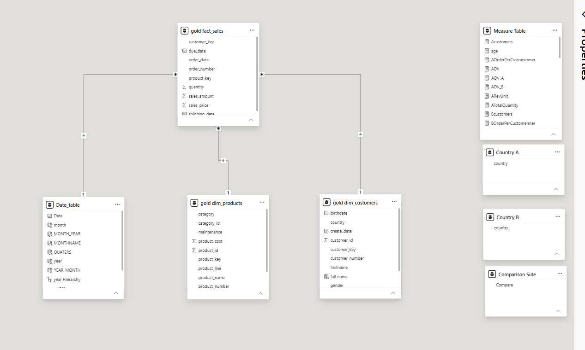
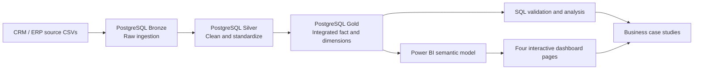
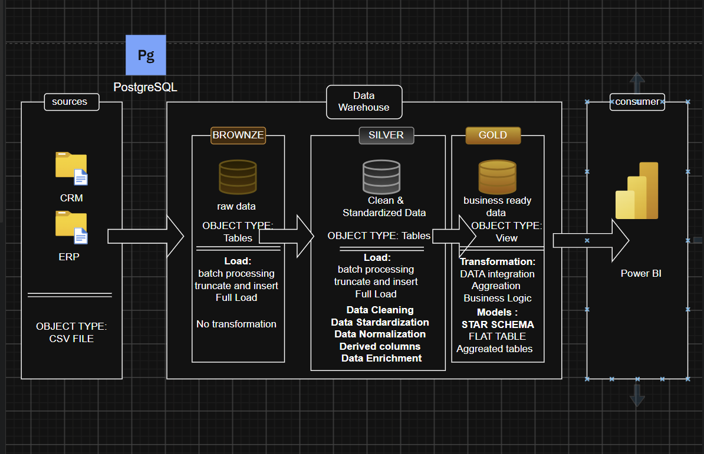

[README (3).md](https://github.com/user-attachments/files/33350214/README.3.md)
# End-to-End Sales Analytics | PostgreSQL, SQL & Power BI

> **From raw CRM/ERP data to a validated, four-page interactive analytics dashboard.** This portfolio project combines a PostgreSQL Bronze–Silver–Gold warehouse, SQL business investigation, dimensional modeling, advanced DAX, and actionable sales insights.



## Project at a glance

| Dimension | Scope |
|---|---|
| Business questions | Which products, customers and countries drive revenue and profit? Why did sales fall in 2012 and recover in 2013? Why do Australia and the US have similar revenue with different customer bases? |
| Data stack | PostgreSQL, SQL, Power BI, DAX |
| Data architecture | CRM/ERP source files → Bronze → Silver → Gold → Power BI |
| Model | Sales fact table with customer, product and date dimensions; disconnected comparison tables |
| Dashboard | Sales Overview · Geographic Insights · Country Comparison · Sales Trends & Growth |
| Key overall metrics | ~29.36M revenue; ~12M profit; ~18K customers; ~28K orders; ~1.06K AOV |

> **Reporting notes:** Monetary values are shown in source-data units (currency not independently confirmed). KPI cards use rounded display values. Annual comparisons focus on full years 2011–2013; 2010 and 2014 have partial-year records.

## 1. Business objectives

- Monitor revenue, profit, orders, customers, average order value (AOV), and profit margin.
- Rank high-performing products and customers by different business outcomes.
- Compare geographic revenue concentration, absolute profit and profit margin.
- Compare any two selected countries using independent slicers and product-value mix.
- Investigate year-on-year changes and distinguish **volume effects** from **unit-value/product-mix effects**.
- Validate dashboard measures against PostgreSQL queries.

## 2. Data architecture



### Bronze — preserve raw source records

- Source data is imported into raw PostgreSQL tables from CRM/ERP CSV files using PostgreSQL-compatible import approaches (`COPY`, `\copy`, or pgAdmin Import/Export).
- Raw tables preserve source structure for traceability; the loading workflow is batch-oriented.

### Silver — improve data quality

- Standardize text using `TRIM` and `CASE` expressions; clean inconsistent categorical values.
- Resolve duplicate customer records with `ROW_NUMBER() OVER (PARTITION BY customer ID ORDER BY creation date DESC)` to retain the latest version where appropriate.
- Apply type conversions, null checks and consistency rules before downstream integration.

### Gold — dimensional analytics layer

- Integrate cleaned CRM and ERP records into a star schema.
- **Fact grain:** one order–product line, not one row per order. Consequently, **orders require `COUNT(DISTINCT order_number)`**, whereas units require `SUM(quantity)`.
- Central table: `gold.fact_sales`; dimensions: `gold.dim_customers`, `gold.dim_products`, and a calendar/date dimension in Power BI.
- Use product and customer keys to preserve consistent join grain and prevent double counting.

### Power BI semantic model


- `gold_fact_sales` is on the **many** side of one-to-many relationships with `gold_dim_customers`, `gold_dim_products`, and `Date_table`.
- `Country A` and `Country B` are **disconnected slicer tables**, supporting independent country selection.
- `Comparison Side` is a disconnected two-row table (`Country A`, `Country B`) used as the axis of a dynamic comparison chart.
- Measures are organized in a dedicated `Measure Table`.
- Date filtering and prior-year comparisons are implemented through the date dimension; model filter direction should be verified in the final PBIX.

## 3. SQL techniques demonstrated

| Technique | How it contributes |
|---|---|
| `INNER JOIN` / `LEFT JOIN` | Integrate sales with customer and product dimensions; retain unmatched rows where needed for audits |
| `GROUP BY`, `HAVING`, `COUNT(DISTINCT ...)` | Aggregate sales by year, category, country and customer; count distinct orders correctly |
| CTEs (`WITH`) | Break multi-stage investigations into readable steps: annual totals, mix analysis and comparisons |
| `ROW_NUMBER()` window function | Customer deduplication in Silver; ranking and quality-control workflows |
| Window-based prior-period comparisons (`LAG` or equivalent) | Useful for year-on-year investigation; include the actual SQL script used before claiming this specific implementation |
| `CASE` and conditional aggregation | Standardize values and classify higher- versus lower-value products |
| `NULLIF`, `COALESCE`, `ROUND` | Defensive ratio calculations, missing values and display formatting |
| Date extraction and time grouping | Annual and monthly sales analysis, with partial-year caveats |
| Grain checks and reconciliation | Avoid fan-out, verify sums and reconcile Power BI against PostgreSQL |

**Suggested proof:** Link each technique to its actual SQL file and show a short excerpt. Do not claim techniques without the corresponding script.

## 4. Power BI and DAX skills demonstrated

| Skill | Project application |
|---|---|
| Star schema and relationship modeling | Fact/dimension model with reusable calendar |
| Measures and `DIVIDE()` | Revenue, profit, AOV, revenue per unit, profit margin, orders/customer |
| `CALCULATE()` and filter context | Context-aware country and category measures |
| `SELECTEDVALUE()` | Read selected countries and comparison-side chart row |
| `TREATAS()` | Apply disconnected Country A/B selections to the customer dimension |
| `SWITCH()` | Route comparison chart rows to Country A or Country B measures |
| `DATATABLE()` | Build the two-row `Comparison Side` table |
| Iterators and product-value classification (`MEDIANX`, `SUMX`, `FILTER`) | Compare higher- and lower-value Bike quantity share using a consistent global product-value threshold |
| Date intelligence / previous-year measures | Year-on-year revenue growth and absolute category change |
| Conditional formatting | Diverging positive/negative YoY growth colors; revenue gradient bars |
| Bookmarks and bookmark navigator | Toggle between Geographic Revenue Map and Country Revenue Rankings without resetting slicers |
| Drill-down and dynamic titles | Year → Month trends and country-dependent chart titles |
| 100% stacked bar with disconnected axis | Side-by-side Country A/B product quantity-share comparisons |

**Illustrative disconnected axis table from the project:**

```dax
Comparison Side =
DATATABLE(
    "Compare", STRING,
    { {"Country A"}, {"Country B"} }
)
```

`Comparison Side[Compare]` controls **which measure** the chart evaluates; Country A/B slicers control **which country's data** those measures use.

## 5. Dashboard walkthrough

### Page 1 — Sales Overview

Executive KPIs, Top 10 Products by Revenue, AOV by Category, Top 10 Customers by Revenue, Top 10 Customers by Orders, and Top 10 Products by Profit Margin.

### Page 2 — Geographic Insights

Interactive revenue-bubble map with bookmark toggle to country rankings, revenue by category, country profit margin and absolute profit. Geographic data is missing for approximately **1.8% of customers**, retained as N/A.

### Page 3 — Country Comparison

Independent Country A/B selectors, matching KPI panels, Top 10 Product rankings and a higher- versus lower-value product quantity-share comparison.

### Page 4 — Sales Trends & Growth

Year/month revenue trend, YoY revenue growth, category contribution to YoY change, and Units Sold vs Revenue per Unit growth drivers. A fixed historical case study summarizes the 2012 decline and 2013 recovery.

## 6. Business findings and analysis

### Case study A — Why did 2012 revenue decline despite more orders?

| Metric | 2011 | 2012 | Interpretation |
|---|---:|---:|---|
| Revenue | 7.075M | 5.842M | **−17.43%** |
| Orders | 2,216 | 3,269 | **+47.5%** |
| Units sold | 2,216 | 3,397 | More units did not prevent revenue decline |
| Revenue per unit | 3,192.73 | 1,719.82 | **~−46.1%** |

**Finding:** Sales shifted toward lower-value Bike products, notably in the US, reducing average revenue per unit despite increased order activity. **Business implication:** monitor product-value mix, not only order volume; investigate merchandising and targeted high-value Bike promotions.

### Case study B — What drove the 2013 recovery?

| Metric | 2012 | 2013 |
|---|---:|---:|
| Revenue | 5.842M | 16.345M |
| YoY revenue growth | — | **+179.77%** |
| Units sold | 3,397 | 52,807 |
| Revenue per unit | 1,719.82 | 309.52 |

**Finding:** Growth was **volume-driven**, not a recovery in revenue per unit. Bikes added approximately **9.5M** in revenue; Accessories added approximately **0.7M**, and Clothing approximately **0.3M**. **Business implication:** sustain cross-selling and accessory/clothing expansion while monitoring whether declining unit value affects profitability.

### Case study C — How did Australia nearly match US revenue with fewer customers?

| Metric | Australia | United States |
|---|---:|---:|
| Revenue | 9.06M | 9.16M |
| Customers | 3,591 | 7,482 |
| Orders | 6,718 | 9,230 |
| AOV | 1,348.64 | 992.67 |
| Orders per customer | 1.87 | 1.23 |
| Higher-value Bike unit share | 78.87% | 71.87% |

**Finding:** Australia achieved comparable revenue with fewer customers through greater purchase frequency, higher average order value and a stronger higher-value Bike mix. **Business implication:** test repeat-purchase and higher-value Bike conversion strategies in the US. These are explanatory associations, not proven causal effects.

> **Interpretation guardrail:** These case studies are historical, fixed-scope analyses; dashboard slicers can show different countries, years or categories. The Australia–US revenue figures cover all product categories, while the higher-value Bike shares are Bike-specific.

## 7. Data quality and validation

- Reconciled Power BI KPIs with independent PostgreSQL calculations.
- Checked distinct order counting at the **order-line grain**.
- Validated country and product rankings, profitability measures, AOV and YoY changes.
- Preserved N/A geography instead of inventing country values.
- Investigated 15 orders with missing order dates (19 units; 4,992 revenue) and excluded blank dates from time-series visuals where appropriate, without silently discarding their sales from overall totals.
- Excluded incomplete years from comparable annual-growth narratives.
- Checked disconnected slicer behavior, bookmark persistence and visual interactions.

## 8. Business recommendations

1. **Monitor mix-adjusted revenue performance:** pair order counts with revenue per unit and product-value mix.
2. **Increase high-value Bike conversion:** investigate targeted offers and customer segmentation, particularly in the US.
3. **Develop cross-selling:** leverage growing Accessories and Clothing unit volumes to increase basket value.
4. **Manage geographic performance on two dimensions:** compare **total profit** and **profit margin %**, not one alone.
5. **Strengthen reporting quality:** keep missing-data and partial-year caveats visible.

## 9. Repository structure

```text
data-warehouse-analytics-project/
├── datasets/
│   ├── crm/
│   └── erp/
├── docs/
│   ├── data_architecture.png
│   ├── data_architecture.drawio
│   ├── data_flow.drawio
│   ├── data_models.drawio
│   ├── power_bi_model.png
│   ├── data_catalog.md
│   └── naming-conventions.md
├── scripts/
│   ├── bronze/
│   │   ├── ddl_bronze.sql
│   │   └── load_bronze.sql
│   ├── silver/
│   │   ├── ddl_silver.sql
│   │   └── load_silver.sql
│   └── gold/
│       └── ddl_gold.sql
├── analytics/
│   ├── customer_analysis.sql
│   ├── product_analysis.sql
│   ├── sales_analysis.sql
│   └── case_studies/
│       ├── australia_vs_us.sql
│       └── revenue_decline_recovery.sql
├── tests/
│   └── data_quality_checks.sql
├── dashboard/
│   ├── sales_analysis.pbix
│   ├── dax_measures.md
│   └── screenshots/
│       ├── sales_overview.png
│       ├── geographic_insights.png
│       ├── country_comparison.png
│       └── sales_trends_growth.png
├── insights/
│   ├── business_findings.md
│   └── recommendations.md
├── README.md
├── LICENSE
└── .gitignore
```

The diagram and script paths above retain the **existing repository organization**; newly proposed paths are for additions. Some images and SQL files are not bundled with this README and must be copied from the existing GitHub repository or exported from Power BI.

### Original warehouse architecture



**Sources:** CRM and ERP CSV files. **Bronze:** raw PostgreSQL tables, batch/full-load truncate-and-insert. **Silver:** cleaned and standardized tables with deduplication, null handling, type checks, derived fields, and integration. **Gold:** business-ready dimensional models and SQL analytical layer. **Consumer:** Power BI interactive reports.

For editable diagrams, see `docs/data_architecture.drawio`, `docs/data_flow.drawio`, and `docs/data_models.drawio` in the existing repository.

## 10. Learning attribution

This portfolio originated as a guided learning implementation based on the **Data With Baraa SQL Data Warehouse Project**. The original learning material informed the warehouse structure and initial implementation. My additional work includes SQL investigations, KPI validation, a four-page Power BI dashboard, DAX-based country comparison, and business case studies. I distinguish these additions from the guided foundation rather than presenting the entire warehouse concept as original.

## 11. Skills evidenced

**Data engineering:** PostgreSQL, layered medallion architecture, ingestion, data quality, dimensional modeling.  
**SQL:** joins, CTEs, window functions, aggregations, conditional logic, temporal analysis, data-grain validation.  
**Business analytics:** KPI design, product/customer segmentation, country comparison, product-mix and volume-vs-value decomposition, actionable recommendations.  
**Power BI:** semantic modeling, advanced DAX, disconnected slicers, filter context, conditional formatting, drill-down, bookmarks, and dashboard UX.

## Reproducibility and limitations

- Add actual source file descriptions, SQL scripts, exact DAX definitions and the final `.pbix` before publishing.
- Confirm source licensing and **do not upload private customer data, database credentials or connection secrets**.
- Currency is not asserted until the source-data currency is verified.
- The 2010 and 2014 records represent partial years; some records lack dates or geographic attributes.
- Findings are observational; recommended interventions require testing before attributing causal impact.

---

*Built as an end-to-end portfolio project to connect reliable data pipelines, transparent analysis and decision-oriented BI.*


## Author

**Grusha Pabbi** — Data Analyst portfolio project.
